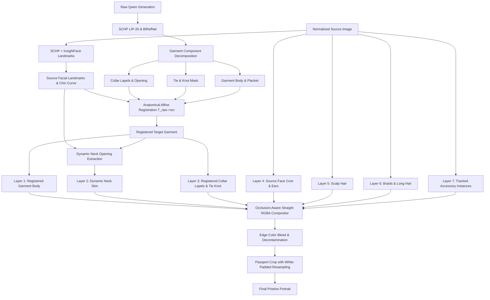

# V13.3.3 Compositing Architecture: Anatomical Garment Registration & Semantic Occlusion-Aware Blending

**Date**: 2026-11-27  
**Branch**: `v13.3-production-stabilization`  
**Target Module**: `pipelines/uniform_swap/`  
**Status**: DESIGN SPECIFICATION  

---

## 1. System Overview

V13.3.3 replaces the legacy flat-paste compositor with a **two-way anatomical garment registration and 7-layer semantic occlusion-aware compositing engine**.



---

## 2. Mathematical Garment Registration ($T_{\text{raw}\to\text{src}}$)

### A. Coordinate Transformation
Let $L_{\text{src}} = \{p_i^{\text{src}}\}_{i=1}^N$ be the key facial landmarks (pupils, nose tip, mouth corners, jaw/chin) extracted from the source portrait.  
Let $L_{\text{raw}} = \{p_i^{\text{raw}}\}_{i=1}^N$ be the corresponding landmarks detected on the raw Qwen candidate.

The optimal similarity transformation matrix $M \in \mathbb{R}^{2 \times 3}$:
$$M = \arg\min_{M} \sum_{i=1}^N \| p_i^{\text{src}} - M \begin{bmatrix} p_i^{\text{raw}} \\ 1 \end{bmatrix} \|^2$$

Where $M$ encodes:
- Uniform scale factor $S = \sqrt{\det(M_{1:2, 1:2})}$ (typically $1.25\text{--}1.38$)
- Rotation angle $\theta = \arctan2(M_{2,1}, M_{1,1})$
- Translation vector $[\Delta x, \Delta y]^T$

### B. Garment Component Warping
Every garment component extracted from the raw Qwen candidate is transformed into the authentic source anatomical coordinate space:
$$\text{RGB}_{\text{reg}}(x, y) = \text{warpAffine}(\text{RGB}_{\text{cand}}, M, (W, H), \text{INTER\_LANCZOS4})$$
$$\alpha_{\text{reg}}(x, y) = \text{warpAffine}(\alpha_{\text{cand}}, M, (W, H), \text{INTER\_LINEAR})$$

**Key Benefits**:
1. The collar opening automatically aligns with the authentic student's throat and jawline.
2. The collar lapels scale proportionally with the student's face size.
3. The tie knot aligns perfectly beneath the collar opening.
4. Shoulder silhouette matches the student's true anatomical width.

---

## 3. Dynamic Semantic Layer Decomposition

| Layer | Component | Source | Definition & Occlusion Rules |
| :---: | :--- | :--- | :--- |
| **0** | Canvas Base | Generated | Transparent RGBA canvas $(W, H, 4)$ |
| **1** | Target Garment Body | Raw Qwen (Warped) | Shirt body, placket, tailored buttons, vest, sleeves, and shoulders. Extended laterally to cover authentic person silhouette. |
| **2** | Dynamic Neck Skin | Source Portrait | Defined strictly as: $\text{SourceSkin} \cap \text{RegisteredCollarOpening} \cap (y \ge y_{\text{chin}})$. Never overlaps collar fabric. |
| **3** | Collar Lapels & Tie Knot | Raw Qwen (Warped) | Left collar, right collar, collar band, and tie knot. Layered **ON TOP** of Layer 2 (neck skin), guaranteeing collar completeness. |
| **4** | Facial Core & Ears | Source Portrait | 100% unaltered authentic pixels of eyes, nose, mouth, chin, ears, earrings, glasses, bindi. Bounded by BiRefNet matte. |
| **5** | Scalp Hair | Source Portrait | Upper hair crown and temples with soft alpha transition onto forehead. |
| **6** | Braids & Long Hair | Source Portrait | Draping hair sections layered over uniform shoulders and chest where present in the original photograph. |
| **7** | Accessory Instances | Source Portrait | Individual bow instances (loops + tails), ribbons, floral barrettes, and clips attached to hair instances. |

---

## 4. Elimination of Black Shoulder Outlines

### A. Pre-Resampling Color Bleeding
To prevent transparent black `(0, 0, 0, 0)` from contaminating subject boundaries during downsampling:
1. Identify all transparent boundary pixels ($\alpha = 0$).
2. Apply normalized radial color extension (bleeding) using OpenCV Telea or nearest-neighbor Voronoi fill on RGB channels outside the alpha mask.
3. Boundary RGB channels carry the authentic fabric / skin / hair color outward by $\ge 15\text{ px}$.

### B. White-Padded Resampling in Passport Crop
In `image_normalizer.py`:
- Replace `Image.new("RGBA", (new_w, new_h), (0, 0, 0, 0))` with:
  `Image.new("RGBA", (new_w, new_h), background_rgb + (0,))`.
- Lanczos downsampling now filters boundary pixels against the target background color (e.g. white `(255, 255, 255)`), completely eliminating dark/black contour rings.

---

## 5. Instance-Level Accessory Preservation Engine

### A. Instance Correspondence Data Model
For each accessory object in the source portrait:
```python
@dataclass
class AccessoryInstance:
    instance_id: str             # e.g. "maroon_bow_left", "maroon_bow_right", "floral_clip"
    mask: np.ndarray             # (H, W) bool binary mask
    bbox: Tuple[int, int, int, int]
    centroid: Tuple[float, float]
    area: int
    mean_rgb: Tuple[float, float, float]
    mean_hsv: Tuple[float, float, float]
    hair_attachment_pt: Tuple[float, float]
    is_bilateral: bool           # True if pair exists (e.g. dual bows)
```

### B. Dual Maroon Bows in PA_03
- Braid tails for PA_03 reach $y = 650\text{--}900$.
- The left bow is extracted as an independent instance (`area \ge 3,500 px`) and tracked through the entire compositing stack.
- Gate 7 enforces independent survival: $\text{area}_{\text{final}} / \text{area}_{\text{initial}} \ge 0.75$ for **both** left and right instances.

### C. Generalized Accessory Extraction (PA_04 Floral Bow)
- Extraction operates without metadata or filename reliance.
- Chromatic delta against scalp hair ($\Delta E > 25$), bright light reflectance, and structural connectivity to hair ensure that floral bows and clips in PA_04 are detected and preserved.

---

## 6. Backward Compatibility & Feature Flagging

To ensure zero disruption to existing endpoints:
- A new configuration parameter `compositor_version: str = "v13_3_3"` (default) is added to `UniformSwapConfig`.
- If set to `"v13_3_2"`, the orchestrator executes the previous compositing route.
- All response structures, FastAPI routes, and diagnostic file conventions remain strictly preserved.
